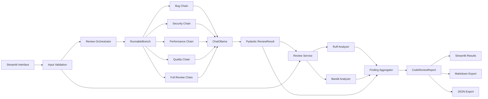
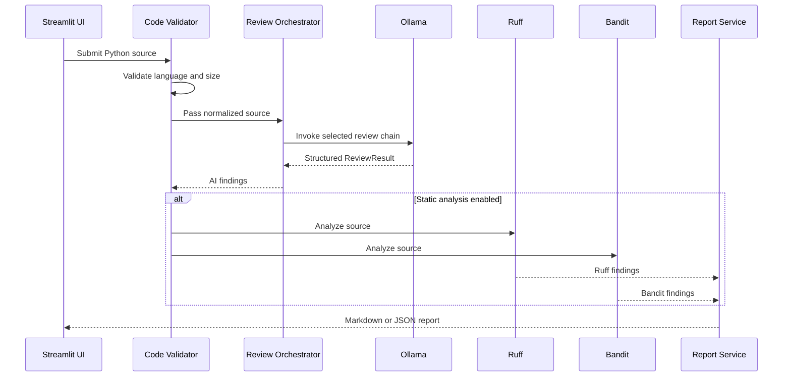

# CodeSense AI

CodeSense AI is an air-gapped, AI-assisted source-code review application for Python. It combines LangChain orchestration, a locally hosted Ministral model through Ollama, Pydantic v2 structured output, and deterministic analysis from Ruff and Bandit.

The application provides an interactive Streamlit interface and exports review reports as Markdown or JSON.

## Table of Contents

- [Overview](#overview)
- [Key Features](#key-features)
- [System Architecture](#system-architecture)
- [Review Pipeline](#review-pipeline)
- [Technology Stack](#technology-stack)
- [Prerequisites](#prerequisites)
- [Installation](#installation)
- [Configuration](#configuration)
- [Running the Application](#running-the-application)
- [Using CodeSense AI](#using-codesense-ai)
- [Report Structure](#report-structure)
- [Testing](#testing)
- [Project Structure](#project-structure)
- [Limitations](#limitations)
- [Security and Privacy](#security-and-privacy)

## Overview

CodeSense AI is designed to support a code-review workflow in environments where source code must remain local.

The system:

1. Accepts Python source code entered directly or uploaded as a `.py` file.
2. Validates and normalizes the input.
3. Routes the review according to the selected review type.
4. Requests a structured response from a local Ollama model.
5. Runs Ruff and Bandit when static analysis is enabled.
6. Combines model findings with static-analysis findings.
7. Presents and exports a unified review report.

No submitted source code is executed by the application.

## Key Features

- Specialized review modes for bugs, security, performance, and code quality.
- Full-review mode for one multi-area model invocation.
- LangChain LCEL chains and `RunnableBranch` routing.
- Local model inference through Ollama.
- Pydantic v2 schema validation and normalized confidence scores.
- Optional Ruff and Bandit static analysis.
- Markdown and JSON report downloads.
- UTF-8 source-file uploads.
- Configurable code-length and analyzer-timeout limits.

## System Architecture



## Review Pipeline



### Structured Confidence Score

Confidence values are normalized to the interval $[0,1]$:

$$
c_{\mathrm{normalized}} =
\begin{cases}
\dfrac{c}{100}, & 1 < c \leq 100, \\[4pt]
c, & 0 \leq c \leq 1.
\end{cases}
$$

The confidence field is validated with Pydantic and rejected when it falls outside the accepted range.

## Technology Stack

| Component | Technology |
|---|---|
| User interface | Streamlit |
| Model orchestration | LangChain Core |
| Local model runtime | Ollama |
| Model | Ministral 3B |
| Structured output | Pydantic v2 |
| Python static analysis | Ruff |
| Security static analysis | Bandit |
| Testing | pytest |
| Configuration | python-dotenv |

## Prerequisites

- Windows 10 or later
- Python 3.11 or later
- Ollama installed and available locally
- PowerShell
- Internet access only for initial installation and model retrieval

## Installation

Create and activate a virtual environment:

```powershell
py -3.11 -m venv .venv
.\.venv\Scripts\Activate.ps1
python -m pip install --upgrade pip
pip install -r requirements.txt
```

Create the local environment file:

```powershell
Copy-Item .env.example .env
```

Install and start Ollama, then download the configured model:

```powershell
ollama pull ministral-3:3b
ollama serve
```

Keep the Ollama server running while using CodeSense AI.

## Configuration

The application loads configuration from environment variables in `.env`.

| Variable | Default | Description |
|---|---:|---|
| `OLLAMA_BASE_URL` | `http://localhost:11434` | Ollama API endpoint |
| `OLLAMA_MODEL` | `ministral-3:3b` | Locally hosted model |
| `OLLAMA_TEMPERATURE` | `0.1` | Sampling temperature |
| `MAX_CODE_CHARS` | `20000` | Maximum submitted source length |
| `ANALYZER_TIMEOUT_SECONDS` | `15` | Static analyzer timeout |

Example `.env` file:

```dotenv
OLLAMA_BASE_URL=http://localhost:11434
OLLAMA_MODEL=ministral-3:3b
OLLAMA_TEMPERATURE=0.1

MAX_CODE_CHARS=20000
ANALYZER_TIMEOUT_SECONDS=15
```

## Running the Application

From the project root:

```powershell
streamlit run app.py
```

Streamlit normally opens the application at `http://localhost:8501`.

## Using CodeSense AI

1. Choose **Python** as the language.
2. Select a review type:
   - Full review
   - Bug and correctness
   - Security
   - Performance
   - Code quality
3. Choose whether to run Ruff and Bandit.
4. Paste source code or upload a UTF-8 `.py` file.
5. Start the review.
6. Inspect findings and download the report.

Review output includes issue title, category, severity, source, line number, confidence, description, and a suggested fix.

## Report Structure

A complete report contains:

- Language and review type
- Overall summary
- Positive observations
- AI and static-analysis findings
- Severity and category metadata
- Line numbers when known
- Confidence scores
- Suggested fixes
- Analysis limitations

### Severity Levels

| Severity | Meaning |
|---|---|
| Critical | Requires immediate attention |
| High | Significant correctness or security risk |
| Medium | Material issue with limited scope or impact |
| Low | Minor issue or improvement |
| Info | Contextual observation |

## Testing

Run the test suite:

```powershell
pytest -q
```

The tests cover:

- Review service behavior
- Pydantic schema validation
- Source and language validation
- Static-analysis fallback behavior

## Project Structure

```text
codeSense-AI/
├── app.py
├── config/
│   └── settings.py
├── src/
│   ├── analyzers/
│   │   ├── bandit_analyzer.py
│   │   └── ruff_analyzer.py
│   ├── chains/
│   │   ├── review_chain.py
│   │   └── review_orchestrator.py
│   ├── llm/
│   │   └── mistral_client.py
│   ├── prompts/
│   │   └── review_prompts.py
│   ├── schemas/
│   │   └── review_schema.py
│   ├── services/
│   │   ├── code_validator.py
│   │   ├── report_service.py
│   │   └── review_service.py
│   └── utils/
│       └── formatters.py
├── tests/
│   ├── test_review.py
│   ├── test_schema.py
│   └── test_validation.py
├── requirements.txt
└── .env.example
```

## Limitations

- Version 1 supports Python source code only.
- AI findings are recommendations, not proof of defects or vulnerabilities.
- Static analysis does not guarantee security or correctness.
- Model availability and quality depend on the local Ollama installation.
- Small or ambiguous code snippets may produce uncertain findings.
- The application does not execute submitted source code.
- A human reviewer and an appropriate test process remain necessary.

## Security and Privacy

CodeSense AI is intended for local, air-gapped use. Model inference is performed against a local Ollama endpoint rather than an external hosted API.

Before analysis:

- Remove credentials and secrets from source snippets.
- Avoid confidential or proprietary source in unapproved environments.
- Review exported reports before sharing them.
- Apply organizational security, retention, and approval policies.

CodeSense AI is assistive tooling and is not a replacement for approved secure-development review processes.
